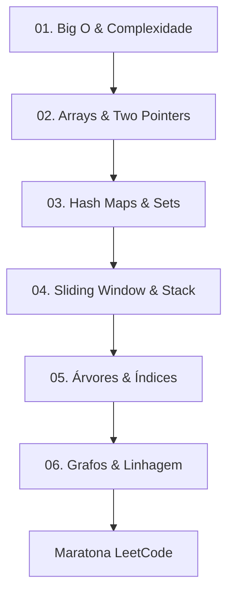

# 🏗️ MOC - Estruturas de Dados e Algoritmos para DE

Este Mapa de Conteúdo (MOC) foca na preparação para entrevistas técnicas (LeetCode Style) e na aplicação prática de estruturas de dados para otimizar pipelines de engenharia de dados.

## 🗺️ Mapa de Progressão

## 📚 Trilhas de Aprendizado

| Cap | Título | Foco LeetCode | Horas | Status | Domínio | Link |
| :--- | :--- | :--- | :---: | :---: | :---: | :--- |
| 01 | Big O & Complexidade | Análise de Tempo/Espaço | 4 | nao-iniciado | 0 | [[Estruturas-Dados/01-Big-O/01-Aula\|Aula]] |
| 02 | Arrays & Two Pointers | Slicing, Two Pointers, Sorting | 6 | nao-iniciado | 0 | [[Estruturas-Dados/02-Arrays-TwoPointers/01-Aula\|Aula]] |
| 03 | Hash Maps & Sets | Frequency Counters, O(1) Lookup | 6 | nao-iniciado | 0 | [[Estruturas-Dados/03-HashMaps-Sets/01-Aula\|Aula]] |
| 04 | Sliding Window & Stack | Subarrays, Parenteses, Undo | 6 | nao-iniciado | 0 | [[Estruturas-Dados/04-SlidingWindow-Stack/01-Aula\|Aula]] |
| 05 | Árvores & Índices | BFS, DFS, Binary Search Tree | 8 | nao-iniciado | 0 | [[Estruturas-Dados/05-Arvores-Indices/01-Aula\|Aula]] |
| 06 | Grafos & Linhagem | Adj List, Topological Sort | 8 | nao-iniciado | 0 | [[Estruturas-Dados/06-Grafos-Linhagem/01-Aula\|Aula]] |

## 🎯 Objetivo Final da Trilha
Ser capaz de resolver problemas de nível "Easy" e "Medium" do LeetCode com a complexidade temporal e espacial ótima, aplicando esses conceitos para otimizar a leitura e escrita de dados em escala.

## 🏁 Preparação para Entrevista
- [[Estruturas-Dados/Simulado-LeetCode|Simulado de Coding Interview]]
- [[Estruturas-Dados/Cheat-Sheet-Complexidade|Cheat Sheet de Complexidade]]

## 📖 Fontes Confiáveis
- [LeetCode Explore](https://leetcode.com/explore/)
- [NeetCode.io](https://neetcode.io/) (Roadmap de referência para entrevistas)
- [GeeksforGeeks - DSA](https://www.geeksforgeeks.org/data-structures/)
- [MIT OpenCourseWare - Introduction to Algorithms](https://ocw.mit.edu/)

---
← [[Python/Projeto-Final-Python]] · [[MOC-Python]] · [[Estruturas-Dados/01-Big-O/01-Aula]] →
