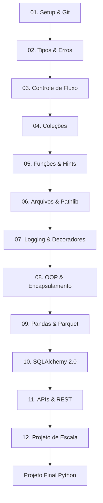

# 🐍 MOC - Python para Engenharia de Dados

Este Mapa de Conteúdo (MOC) organiza a jornada de aprendizado de Python, focando na transição de Backend Java para a manipulação de grandes volumes de dados.

## 🗺 Mapa de Progressão

## 📚 Trilhas de Aprendizado

| Cap | Título | Nível | Horas | Status | Domínio | Link |
| :--- | :--- | :---: | :---: | :---: | :---: | :--- |
| 01 | Setup & Git | 1 | 4 | nao-iniciado | 0 | [[Python/01-Setup-Git/01-Aula\|Aula]] |
| 02 | Tipos, Conversão e Erros | 1 | 5 | nao-iniciado | 0 | [[Python/02-Tipos-Conversao-Erros/01-Aula\|Aula]] |
| 03 | Controle de Fluxo | 2 | 5 | nao-iniciado | 0 | [[Python/03-Controle-Fluxo/01-Aula\|Aula]] |
| 04 | Coleções (Lists, Dicts, Sets) | 2 | 6 | nao-iniciado | 0 | [[Python/04-Colecoes/01-Aula\|Aula]] |
| 05 | Funções & Type Hints | 3 | 6 | nao-iniciado | 0 | [[Python/05-Funcoes-TypeHints/01-Aula\|Aula]] |
| 06 | Arquivos (CSV, JSON, Pathlib) | 3 | 6 | nao-iniciado | 0 | [[Python/06-Arquivos-Pathlib/01-Aula\|Aula]] |
| 07 | Logging & Decoradores | 3 | 5 | nao-iniciado | 0 | [[Python/07-Logging-Decoradores/01-Aula\|Aula]] |
| 08 | OOP & Encapsulamento | 4 | 6 | nao-iniciado | 0 | [[Python/08-OOP-Encapsulamento/01-Aula\|Aula]] |
| 09 | Pandas & Parquet | 4 | 8 | nao-iniciado | 0 | [[Python/09-Pandas-Parquet/01-Aula\|Aula]] |
| 10 | SQLAlchemy 2.0 & Sessões | 4 | 6 | nao-iniciado | 0 | [[Python/10-SQLAlchemy-Sessoes/01-Aula\|Aula]] |
| 11 | APIs, REST & CRUD | 4 | 6 | nao-iniciado | 0 | [[Python/11-APIs-REST-CRUD/01-Aula\|Aula]] |
| 12 | Projeto de Escala (1B linhas) | 5 | 8 | nao-iniciado | 0 | [[Python/12-Projeto-Escala/01-Aula\|Aula]] |

## 🎯 Objetivo Final da Trilha
Construir um pipeline de extração e carga idempotente, com tratamento de erros profissional, tipagem rigorosa e alta performance de memória, pronto para ser apresentado em um portfólio de Engenheiro de Dados Júnior.

## 🏁 Avaliações
- [[Python/Simulado-Python|Simulado Técnico Python]]
- [[Python/Projeto-Final-Python|Projeto Final de Portfólio]]
